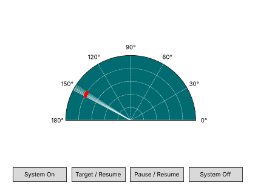

# Ultrasonic Radar Targeting System / 超声波雷达定位系统

[English](#english) | [中文](#中文)



*Running in `--simulate` mode. / 以 `--simulate` 模拟模式运行。*

## English

A servo-mounted ultrasonic sensor sweeps 0–180°, an Arduino streams the readings
over USB serial, and a Python program draws them on a live radar display, finds
the nearest object and can turn the sensor to face it.

Built as a four-week group project for ELEC222 at the University of Liverpool
(Year 2 of the Liverpool programme, Year 3 on the XJTLU 2+2 route), January–February 2025.
Team blog: <https://radarsystem2025.blogspot.com/>

### How it works

```
 Python host (laptop)                       Arduino UNO R4 WiFi
┌──────────────────────────┐   commands    ┌───────────────────────┐
│ main.py     buttons, UI  │ ────────────▶ │ sweep servo (SG90)    │
│ receiver.py serial thread│ ◀──────────── │ ultrasonic ranging    │
│ target.py   nearest obj. │   readings    └───────────────────────┘
│ radar_graph.py  display  │
└──────────────────────────┘
```

| File | Role |
| --- | --- |
| `main.py` | Entry point: window, buttons, update loop |
| `radar_graph.py` | Polar radar display with fading sweep and echoes |
| `receiver.py` | Parses serial lines on a background thread |
| `target.py` | Tracks the latest reading per angle and picks the nearest object |
| `simulator.py` | Software stand-in for the Arduino (same protocol) |
| `firmware/sonar_radar/sonar_radar.ino` | Arduino firmware |

#### Serial protocol (115200 baud, newline-terminated)

| Direction | Message | Meaning |
| --- | --- | --- |
| host → Arduino | `start` | begin sweeping and reporting |
| host → Arduino | `stop` | pause the sweep |
| host → Arduino | `continue` | resume the sweep |
| host → Arduino | `rotate <deg>` | point at an angle and hold |
| Arduino → host | `Angle: 90°, Distance: 23 cm` | one measurement |

### Running it

```bash
pip install -r requirements.txt

python main.py --simulate                    # no hardware needed
python main.py --port COM6                   # Windows
python main.py --port /dev/tty.usbmodemXXXX  # macOS / Linux
```

Buttons: **System On** starts the scan, **Target / Resume** turns the sensor to
the nearest object (click again to resume), **Pause / Resume** pauses the sweep,
**System Off** stops and closes.

Tests: `python -m pytest tests`. Regenerate the demo: `python tools/make_demo.py`.

### Hardware

| Part | Qty |
| --- | --- |
| Arduino UNO R4 WiFi | 1 |
| Ultrasonic distance sensor | 1 |
| SG90 servo | 1 |
| DC geared motors + wheels (dart launcher) | 2 |
| 9 V battery, breadboard, push button, enclosure | – |

Default wiring in the sketch: TRIG → D9, ECHO → D10, servo signal → D6 (change the
pin constants at the top of `sonar_radar.ino` to match your build).

The dart launcher is a separate circuit operated by a physical button, kept
apart from the software for safety; it is not controlled by this code.

---

## 中文

舵机带动超声波传感器在 0–180° 范围内来回扫描，Arduino 通过 USB 串口把测量值发给电脑，
Python 程序把它们实时画在雷达图上，找出最近的物体，并可以让传感器转过去对准它。

本项目是利物浦大学 ELEC222 课程的四周小组项目（利物浦本校的二年级课程，西浦 2+2 路线的大三），
完成于 2025 年 1 月至 2 月。
小组博客：<https://radarsystem2025.blogspot.com/>

### 工作原理

| 文件 | 作用 |
| --- | --- |
| `main.py` | 程序入口：窗口、按钮、刷新循环 |
| `radar_graph.py` | 极坐标雷达图，带渐隐的扫描线和回波点 |
| `receiver.py` | 在后台线程读取并解析串口数据 |
| `target.py` | 记录每个角度的最新读数，找出最近的物体 |
| `simulator.py` | 用软件模拟 Arduino（协议相同） |
| `firmware/sonar_radar/sonar_radar.ino` | Arduino 固件 |

#### 串口协议（115200 波特率，以换行结尾）

| 方向 | 消息 | 含义 |
| --- | --- | --- |
| 电脑 → Arduino | `start` | 开始扫描并回传数据 |
| 电脑 → Arduino | `stop` | 暂停扫描 |
| 电脑 → Arduino | `continue` | 继续扫描 |
| 电脑 → Arduino | `rotate <角度>` | 转到指定角度并保持 |
| Arduino → 电脑 | `Angle: 90°, Distance: 23 cm` | 一次测量结果 |

### 运行方法

```bash
pip install -r requirements.txt

python main.py --simulate                    # 不需要硬件
python main.py --port COM6                   # Windows
python main.py --port /dev/tty.usbmodemXXXX  # macOS / Linux
```

按钮：**System On** 开始扫描；**Target / Resume** 让传感器转向最近的物体，再点一次恢复扫描；
**Pause / Resume** 暂停或继续；**System Off** 停止并关闭窗口。

运行测试：`python -m pytest tests`。重新生成演示动图：`python tools/make_demo.py`。

### 硬件

| 部件 | 数量 |
| --- | --- |
| Arduino UNO R4 WiFi | 1 |
| 超声波测距传感器 | 1 |
| SG90 舵机 | 1 |
| 直流减速电机 + 轮子（飞镖发射器） | 2 |
| 9 V 电池、面包板、按钮、外壳 | – |

固件中的默认接线：TRIG → D9，ECHO → D10，舵机信号线 → D6（可在 `sonar_radar.ino` 开头修改引脚常量）。

飞镖发射器是独立电路，出于安全考虑由实体按钮手动触发，不受本程序控制。
